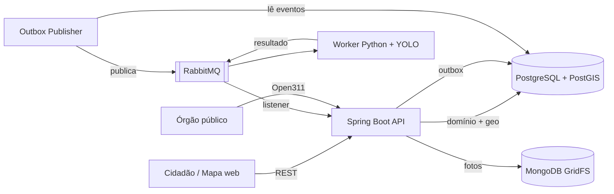
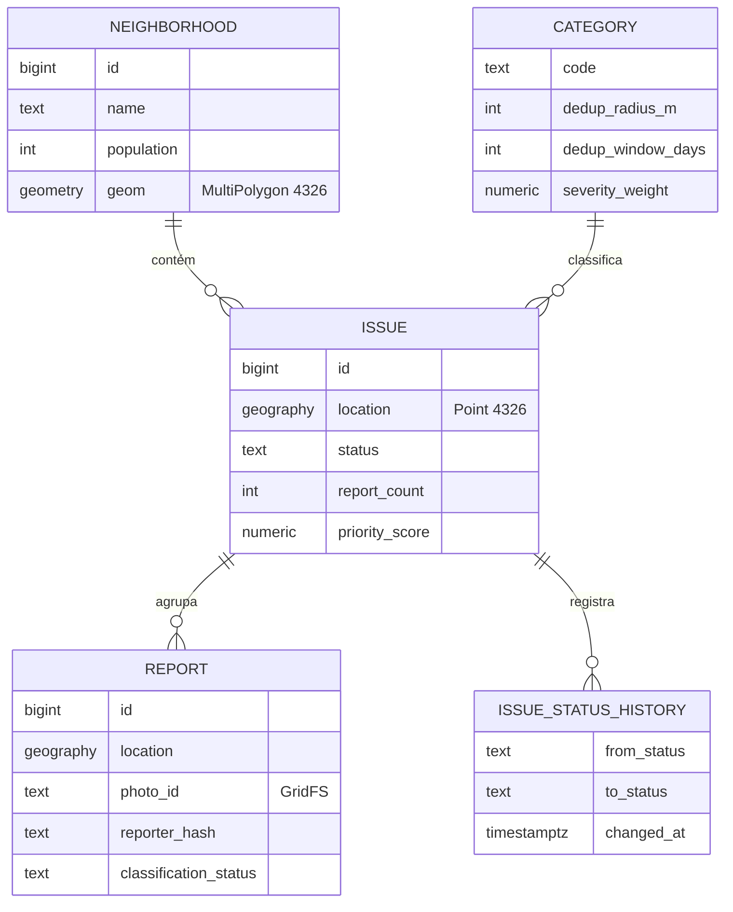

# spbemestar — Zeladoria Urbana Colaborativa

API para o cidadão reportar problemas urbanos — buracos, lixo descartado irregularmente, postes apagados, calçadas sem acessibilidade — com **deduplicação geoespacial**, **priorização por bairro** e **exportação no padrão Open311** para órgãos públicos.

> O cidadão fotografa o problema → a API registra a localização → relatos do mesmo ponto são agrupados em um único chamado → tudo aparece em um mapa com indicadores por bairro.


---

## Sumário

- [O problema](#o-problema)
- [Funcionalidades](#funcionalidades)
- [Arquitetura](#arquitetura)
- [Decisões técnicas](#decisões-técnicas)
- [Modelo de dados](#modelo-de-dados)
- [Endpoints](#endpoints)
- [Como rodar](#como-rodar)
- [Testes](#testes)
- [Estrutura do projeto](#estrutura-do-projeto)
- [Roadmap](#roadmap)

---

## O problema

Canais de zeladoria costumam receber o mesmo problema dezenas de vezes, sem localização precisa e sem nenhuma visão consolidada. O resultado é retrabalho para o órgão público e a sensação, para o cidadão, de que reportar não adianta.

Este projeto ataca três pontos:

1. **Duplicidade** — vários relatos do mesmo buraco viram **um único chamado**, com contador de relatos.
2. **Priorização** — chamados são ordenados por severidade, volume e tempo em aberto, **normalizados pela população do bairro**.
3. **Integração** — os dados saem no padrão aberto **Open311**, consumível por sistemas de prefeituras.

## Funcionalidades

**Cidadão**
- Reportar um problema com foto, localização e categoria
- Visualizar no mapa os problemas abertos, filtrando por categoria e status
- Acompanhar quantas pessoas reportaram o mesmo ponto e o histórico de status

**Órgão público**
- Ranking de bairros por problemas a cada 10 mil habitantes
- Fila de atendimento priorizada
- Atualização de status: `OPEN → CONFIRMED → IN_PROGRESS → RESOLVED`
- Exportação no padrão Open311 GeoReport v2

**Plataforma**
- Classificação automática da foto por modelo de visão computacional (assíncrona)
- Remoção de metadados EXIF e anonimização do autor (LGPD)
- Rate limiting contra spam
- Métricas expostas para Prometheus

## Arquitetura



**Fluxo de um relato**

1. `POST /api/v1/reports` recebe foto, latitude, longitude e categoria.
2. A foto tem o EXIF removido e é gravada no GridFS.
3. A deduplicação procura um chamado aberto da mesma categoria dentro do raio configurado. Se existir, o relato é anexado e o contador sobe; se não, um novo chamado é criado.
4. Na mesma transação, um evento `ReportCreated` é gravado na tabela de outbox.
5. O publisher envia o evento ao RabbitMQ; o worker classifica a imagem e devolve o resultado.
6. Se a categoria prevista divergir da informada (ou a confiança for baixa), o relato é marcado para moderação.

A API **nunca espera o modelo**: a classificação é uma validação posterior, não uma etapa bloqueante.

## Decisões técnicas

### Deduplicação não é só distância
Dois relatos são o mesmo problema quando coincidem **categoria + proximidade + janela de tempo + chamado ainda aberto**. O raio varia por categoria (um poste é um ponto exato; lixo se espalha), e um buraco consertado que reabre gera um chamado novo.

```sql
SELECT i.* FROM issue i
WHERE i.category_code = :category
  AND i.status <> 'RESOLVED'
  AND i.last_reported_at > :since                 -- agora - janela da categoria
  AND ST_DWithin(i.location, :point::geography, :radius)
ORDER BY i.location <-> :point::geography         -- o mais próximo, usando o índice GiST
LIMIT 1;
```

### Concorrência: travar linhas não basta
Dois relatos simultâneos do mesmo buraco podem criar dois chamados: nenhum dos dois encontra linha para travar, porque o chamado ainda não existe. A solução é travar a **área**, não a linha:

- Antes da busca, a transação adquire `pg_advisory_xact_lock` das células de **geohash** que cobrem o quadrado `ponto ± raio`.
- A célula (≈150 m) é maior que esse quadrado, então toda célula que o intercepta contém um dos quatro cantos. Dois relatos a menos de um raio de distância sempre disputam ao menos uma célula em comum — a que contém o ponto médio entre eles —, **inclusive quando estão em lados opostos da borda entre células**.
- Os locks são adquiridos em ordem fixa, o que evita deadlock, e liberados automaticamente no commit.
- Uma mudança de status concorrente com a chegada de um relato é detectada pelo `@Version` do chamado (*optimistic locking*).

Os testes disparam 20 relatos simultâneos no mesmo ponto e na borda entre duas células, e verificam que o resultado é **um único chamado com 20 relatos**.

### `geography` para pontos, `geometry` para polígonos
`ST_DWithin` sobre `geography` mede em **metros reais**, que é o que a deduplicação precisa. Os polígonos de bairro usam `geometry`, mais rápido para `ST_Contains`. Ambos com índice **GiST**.

### Priorização sem viés de volume
Bairros com mais usuários de smartphone reportam mais — o que não significa que tenham mais problemas. Por isso:

```
score = peso_severidade × ln(1 + relatos) × (1 + dias_em_aberto / 30)
```

O `ln` reduz o efeito de volume bruto, o fator de idade impede que chamados antigos sejam esquecidos, e os indicadores de bairro são apresentados **por 10 mil habitantes** (dados do IBGE).

### Outbox transacional
Gravar no banco e publicar no broker em passos separados pode perder ou duplicar eventos. O evento é gravado na **mesma transação** do relato e publicado depois por um processo dedicado. Os consumidores são idempotentes e há **DLQ** para mensagens com falha.

### Persistência poliglota
O domínio é relacional e geoespacial (PostgreSQL + PostGIS); os binários das fotos ficam no **MongoDB GridFS**. O acesso passa pela interface `PhotoStorage`, então migrar para S3 é uma nova implementação, sem tocar no domínio.

### Padrão Open311
Em vez de um formato de exportação próprio, a API implementa o **Open311 GeoReport v2**, padrão aberto adotado por cidades para sistemas de solicitação de serviços.

### Privacidade (LGPD)
- Metadados EXIF são descartados antes do armazenamento.
- O autor do relato é guardado apenas como hash.
- Nenhum endpoint público expõe dados pessoais.

## Modelo de dados



As migrations ficam em `src/main/resources/db/migration` e são aplicadas pelo Flyway. O Hibernate apenas valida o schema (`ddl-auto: validate`).

## Endpoints

| Método | Rota | Descrição |
|---|---|---|
| `POST` | `/api/v1/reports` | Cria um relato (multipart: foto, lat, lon, categoria) |
| `GET` | `/api/v1/issues?bbox=&category=&status=` | Chamados em GeoJSON para o mapa |
| `GET` | `/api/v1/issues/{id}` | Detalhe, relatos e histórico |
| `PATCH` | `/api/v1/issues/{id}/status` | Atualiza o status do chamado |
| `GET` | `/api/v1/neighborhoods/stats` | Indicadores por bairro (normalizados) |
| `GET` | `/api/v1/photos/{id}` | Foto do relato |
| `GET` | `/open311/v2/services.json` | Categorias no padrão Open311 |
| `GET` | `/open311/v2/requests.json` | Chamados no padrão Open311 |

Documentação interativa: `http://localhost:8080/swagger-ui.html`

## Como rodar

**Pré-requisitos:** Java 21 e Docker.

```bash
# 1. Sobe PostgreSQL/PostGIS, RabbitMQ e MongoDB
docker compose up -d --wait

# 2. Executa a aplicação
./mvnw spring-boot:run
```

| Serviço | Endereço |
|---|---|
| API | http://localhost:8080 |
| Swagger UI | http://localhost:8080/swagger-ui.html |
| Health | http://localhost:8080/actuator/health |
| Métricas | http://localhost:8080/actuator/prometheus |
| Painel RabbitMQ | http://localhost:15672 (usuário e senha do `.env`) |

> Na primeira subida com volumes novos, o PostgreSQL reinicia uma vez para instalar a extensão PostGIS. Se a aplicação falhar ao conectar, aguarde alguns segundos e execute novamente.

### Importar bairros

Os limites de bairros são importados de um arquivo **GeoJSON** (`FeatureCollection` com `Polygon` ou `MultiPolygon`). A importação reprojeta para WGS84, corrige geometrias inválidas, atualiza bairros já existentes e associa ao bairro os chamados já registrados.

```bash
./mvnw spring-boot:run -Dspring-boot.run.arguments="--app.neighborhoods.import-file=dados/distritos.geojson --app.neighborhoods.city=São Paulo --app.neighborhoods.name-property=nm_distrito --app.neighborhoods.population-property=populacao --app.neighborhoods.source-srid=31983"
```

| Propriedade | Padrão | Descrição |
|---|---|---|
| `import-file` | — | caminho do GeoJSON |
| `city` | — | cidade dos bairros importados |
| `name-property` | `name` | propriedade com o nome do bairro |
| `population-property` | `population` | propriedade com a população (opcional) |
| `source-srid` | `4326` | sistema de coordenadas do arquivo (ex.: `31983` para SIRGAS 2000 / UTM 23S) |

## Testes

Os testes de integração usam **Testcontainers** com PostGIS, RabbitMQ e MongoDB reais — sem mocks de banco. É necessário ter o Docker em execução.

```bash
./mvnw verify
```

Cenários cobertos:
- relatos próximos da mesma categoria são agrupados no mesmo chamado;
- relatos simultâneos do mesmo ponto não geram chamados duplicados;
- chamados resolvidos não recebem novos relatos;
- transições de status inválidas são rejeitadas;
- indicadores por bairro respeitam a normalização por população;
- eventos da outbox são publicados uma única vez.

## Estrutura do projeto

Organizado em camadas (MVC):

```
src/main/java/com/br/spbemestar/
├── controller/   # endpoints REST e Open311
├── service/      # regras de aplicação: deduplicação, priorização, fotos (GridFS, remoção de EXIF)
├── repository/   # acesso a dados (Spring Data JPA + consultas PostGIS)
├── model/        # entidades JPA e enums: Issue, Report, Category, Neighborhood, OutboxEvent
├── exception/    # exceções de domínio
└── util/         # utilitários geográficos
```

As regras que protegem a consistência de uma entidade ficam nela mesma — por exemplo, `Issue.changeStatus()` valida a transição de status e gera o registro de histórico.

## Stack

| Camada | Tecnologia |
|---|---|
| Linguagem | Java 21 |
| Framework | Spring Boot 4.1 (Web MVC, Data JPA, Data MongoDB, AMQP, Validation, Actuator) |
| Banco relacional | PostgreSQL 16 + PostGIS 3.4 |
| ORM geoespacial | Hibernate Spatial (JTS) |
| Migrations | Flyway |
| Armazenamento de fotos | MongoDB 8 (GridFS) |
| Mensageria | RabbitMQ 4 |
| Classificação | Python + YOLO (worker separado) |
| Documentação | springdoc-openapi |
| Observabilidade | Micrometer + Prometheus |
| Testes | JUnit 6, Testcontainers |

## Roadmap

**Fase 1 — Núcleo**
- [x] Ambiente com Docker Compose (PostGIS, RabbitMQ, MongoDB)
- [x] Schema e migrations
- [x] Criação de relatos com foto no GridFS
- [x] Deduplicação geoespacial
- [x] Consulta de chamados em GeoJSON

**Fase 2 — Bairros e ciclo de vida**
- [x] Importador de bairros (GeoJSON, com reprojeção)
- [ ] Carga dos distritos de São Paulo com população (IBGE)
- [ ] Indicadores normalizados e priority score
- [ ] Ciclo de status com histórico
- [ ] Mapa web (Leaflet)

**Fase 3 — Assíncrono e robustez**
- [ ] Outbox + RabbitMQ com DLQ
- [ ] Worker de classificação (YOLO)
- [ ] Job de merge de duplicatas
- [ ] Rate limiting
- [x] Remoção de EXIF

**Fase 4 — Integração e entrega**
- [ ] Endpoints Open311
- [ ] Carga com dataset público e benchmarks
- [ ] CI com GitHub Actions
- [ ] Deploy com demo pública
