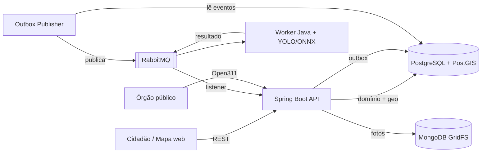
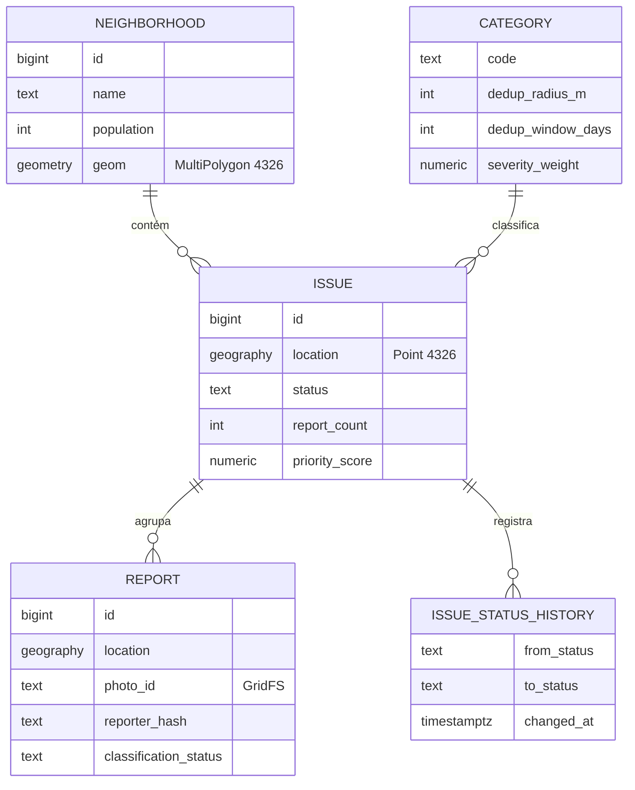

# spbemestar — Zeladoria Urbana Colaborativa

API para o cidadão reportar problemas urbanos — buracos, lixo descartado irregularmente, postes apagados, calçadas sem acessibilidade — com **deduplicação geoespacial**, **priorização por bairro** e **exportação no padrão Open311** para órgãos públicos.

> O cidadão fotografa o problema → a API registra a localização → relatos do mesmo ponto são agrupados em um único chamado → tudo aparece em um mapa com indicadores por bairro.

[](https://github.com/caioeduardopereirafelix/Sp-Bem-Estar/actions/workflows/ci.yml)


---

## Sumário

- [O problema](#o-problema)
- [Funcionalidades](#funcionalidades)
- [Arquitetura](#arquitetura)
- [Decisões técnicas](#decisões-técnicas)
- [Modelo de dados](#modelo-de-dados)
- [Endpoints](#endpoints)
- [Como rodar](#como-rodar)
- [Deploy em produção](#deploy-em-produção-vps)
- [Observabilidade](#observabilidade)
- [Testes](#testes)
- [Estrutura do projeto](#estrutura-do-projeto)
- [Roadmap](#roadmap)

---

## O problema

Canais de zeladoria costumam receber o mesmo problema dezenas de vezes, sem localização precisa e sem nenhuma visão consolidada. O resultado é retrabalho para o órgão público e a sensação, para o cidadão, de que reportar não adianta.

Este projeto ataca três pontos:

1. **Duplicidade** — vários relatos do mesmo buraco viram **um único chamado**, com contador de relatos.
2. **Priorização** — chamados são ordenados por severidade, volume e tempo em aberto, **normalizados pela população do bairro**.
3. **Integração** — os dados saem no padrão aberto **Open311**, consumível por sistemas de prefeituras.

## Funcionalidades

O mapa foi pensado primeiro para o celular e funciona como um app de navegação: abre em tela cheia, com tema escuro, já centralizado em você (uma seta azul que acompanha a posição em tempo real e gira com o rumo ou com a bússola do aparelho), e com uma gaveta recolhida embaixo, onde ficam o botão de relatar e os filtros (no computador, um painel à esquerda). O mapa é vetorial (estilo Fiord do [OpenFreeMap](https://openfreemap.org), com dados do OpenStreetMap), desenhado pelo MapLibre dentro do Leaflet; sem WebGL, ficam os tiles do OpenStreetMap escurecidos. O relato é um passo a passo de três etapas (local, tipo com ícones, foto com prévia) e cada relato mostra a trilha **Recebido → Confirmado → Em andamento → Resolvido**, como o rastreio de uma encomenda. A fonte é a [Atkinson Hyperlegible](https://www.brailleinstitute.org/freefont/), desenhada para ser lida por qualquer pessoa, inclusive com baixa visão, e servida pela própria API (licença OFL em `static/fonts`). A área da prefeitura fica em **Mais › Sou da prefeitura** e, depois do login, numa aba própria.

**Cidadão**
- Reportar um problema com foto, localização e categoria. Antes do relato, um pop-up explica para que serve a localização e leva ao pedido de permissão do aparelho; com a permissão, o ponto vem do GPS, e sem ela o ponto é escolhido no mapa. O marcador pode ser arrastado para corrigir
- Ver no mapa onde a pessoa está, em tempo real, como no Waze: o mapa segue a seta até ela arrastá-lo, e o botão de centralizar volta a seguir. Com o GPS impreciso, aparece o círculo de precisão. Se a posição vier aproximada (mais de 100 m, como num computador sem GPS), o app convida a pessoa a tocar no mapa onde ela está; o ponto marcado vale até o aparelho achar a posição com precisão
- Visualizar no mapa os problemas abertos, filtrando por categoria e status
- Acompanhar quantas pessoas reportaram o mesmo ponto e o histórico de status
- **Meus relatos:** ver os relatos enviados deste navegador e o andamento de cada chamado, sem criar conta
- **Foto recusada com o tipo certo sugerido:** antes de aceitar o relato, a API pergunta ao classificador o que ele vê na foto. Se ele vir, com confiança de 80% ou mais, outro tipo de problema, o envio volta com a sugestão ("A foto parece ser de lixo ou entulho, e não de buraco na rua"), e a pessoa envia com o tipo sugerido, troca a foto ou envia assim mesmo (aí o relato vai para a moderação). Se ele não vir problema de rua nenhum, pede outra foto. Com o worker fora do ar, ou sem `CLASSIFIER_URL`, o relato é aceito como antes
- **Conferência da foto na hora:** logo depois do envio, o app espera alguns segundos pelo classificador e diz se a foto confere com o tipo escolhido, se parece ser de outro tipo ou se não mostra um problema de rua (nos dois últimos casos, a prefeitura confere na moderação). Sem resposta do classificador, avisa que a conferência continua e mostra o andamento em "Meus relatos"
- Receber uma notificação push quando um chamado relatado for confirmado, entrar em andamento ou for resolvido, mesmo com o mapa fechado
- **Instalar como app (PWA):** ícone na tela de início, abre em tela cheia e, no iPhone (iOS 16.4 ou mais novo), recebe as notificações, que lá só funcionam com o app instalado. Em **Mais › Instalar o app**, o Android e o computador mostram o botão do navegador; o iPhone mostra o passo a passo pelo Compartilhar do Safari. Segurar o ícone mostra os atalhos "Relatar um problema" e "Meus relatos". Sem internet, o app abre uma tela que explica o que houve, em vez do erro do navegador; o mapa e os relatos não ficam guardados no aparelho, para nunca mostrar dados velhos
- Ver o **antes e depois**: quando a equipe resolve com uma foto do conserto, o pop-up mostra a foto do relato ao lado da do conserto, com a nota do que foi feito, e "Meus relatos" também
- Termos de uso (`/termos.html`) e política de privacidade (`/privacidade.html`), com o responsável e o contato do encarregado vindos da configuração
- Para o operador logado, o histórico mostra quem fez cada mudança de status (o mapa público mostra o histórico sem nomes)

**Órgão público**
- Ranking de bairros por problemas a cada 10 mil habitantes
- Fila de atendimento: chamados em aberto do mais urgente para o menos, com filtro por categoria, status e bairro
- Resolver com foto e nota: ao marcar um chamado como resolvido, o operador pode anexar a foto do conserto (sem EXIF, como as dos relatos) e uma nota de até 500 caracteres, que vão para o mapa e para o aviso de quem relatou
- Planilha dos chamados (CSV) para o sistema de atendimento do órgão e relatórios, filtrando por tipo, situação e período. Abre direto no Excel em português (UTF-8 com BOM, `;` e vírgula decimal), não leva nenhum dado de quem relatou, protege contra fórmulas injetadas pela nota e cada exportação fica no log com o operador que a fez
- Equipe: o administrador cadastra, desativa e reativa operadores; cada um troca a própria senha
- Fila de moderação: relatos em que o classificador discordou da categoria ou teve pouca confiança; o operador aprova, rejeita ou rejeita e bloqueia o autor
- Atualização de status: `OPEN → CONFIRMED → IN_PROGRESS → RESOLVED`
- Exportação no padrão Open311 GeoReport v2

**Plataforma**
- Classificação automática da foto por modelo de visão computacional (assíncrona)
- Remoção de metadados EXIF e anonimização do autor (LGPD)
- Rate limit por IP contra spam e força bruta no login
- Métricas expostas para Prometheus

## Arquitetura



**Fluxo de um relato**

1. `POST /api/v1/reports` recebe foto, latitude, longitude e categoria.
2. A foto tem o EXIF removido e é gravada no GridFS.
3. A deduplicação procura um chamado aberto da mesma categoria dentro do raio configurado. Se existir, o relato é anexado e o contador sobe; se não, um novo chamado é criado.
4. Na mesma transação, um evento `ReportCreated` é gravado na tabela de outbox.
5. O publisher envia o evento ao RabbitMQ; o worker lê a foto no GridFS, classifica a imagem e publica o resultado (`ReportClassified`).
6. A API grava o resultado no relato. Se a categoria prevista divergir da informada (`MISMATCH`) ou a confiança for baixa (`LOW_CONFIDENCE`), o relato fica marcado para moderação.

A API **nunca espera o modelo**: a classificação é uma validação posterior, não uma etapa bloqueante.

## Decisões técnicas

### Deduplicação não é só distância
Dois relatos são o mesmo problema quando coincidem **categoria + proximidade + janela de tempo + chamado ainda aberto**. O raio varia por categoria (um poste é um ponto exato; lixo se espalha), e um buraco consertado que reabre gera um chamado novo.

```sql
SELECT i.* FROM issue i
WHERE i.category_code = :category
  AND i.status <> 'RESOLVED'
  AND i.last_reported_at > :since                 -- agora - janela da categoria
  AND ST_DWithin(i.location, :point::geography, :radius)
ORDER BY i.location <-> :point::geography         -- o mais próximo, usando o índice GiST
LIMIT 1;
```

### Concorrência: travar linhas não basta
Dois relatos simultâneos do mesmo buraco podem criar dois chamados: nenhum dos dois encontra linha para travar, porque o chamado ainda não existe. A solução é travar a **área**, não a linha:

- Antes da busca, a transação adquire `pg_advisory_xact_lock` das células de **geohash** que cobrem o quadrado `ponto ± raio`.
- A célula (≈150 m) é maior que esse quadrado, então toda célula que o intercepta contém um dos quatro cantos. Dois relatos a menos de um raio de distância sempre disputam ao menos uma célula em comum — a que contém o ponto médio entre eles —, **inclusive quando estão em lados opostos da borda entre células**.
- Os locks são adquiridos em ordem fixa, o que evita deadlock, e liberados automaticamente no commit.
- Uma mudança de status concorrente com a chegada de um relato é detectada pelo `@Version` do chamado (*optimistic locking*).

Os testes disparam 20 relatos simultâneos no mesmo ponto e na borda entre duas células, e verificam que o resultado é **um único chamado com 20 relatos**.

### `geography` para pontos, `geometry` para polígonos
`ST_DWithin` sobre `geography` mede em **metros reais**, que é o que a deduplicação precisa. Os polígonos de bairro usam `geometry`, mais rápido para `ST_Contains`. Ambos com índice **GiST**.

### Priorização sem viés de volume
Bairros com mais usuários de smartphone reportam mais — o que não significa que tenham mais problemas. Por isso:

```
score = peso_severidade × ln(1 + pessoas) × (1 + dias_em_aberto / 30)
```

- **Pessoas, não relatos:** contam os autores distintos dos relatos (pelo `reporter_hash`), sem os rejeitados pela moderação. Quem reporta o mesmo buraco cinco vezes conta uma, então insistir não fura a fila. Relatos anteriores à identidade anônima não têm autor e contam um cada.
- **O `ln`** reduz o efeito de volume bruto.
- **O fator de idade** impede que chamados antigos sejam esquecidos.
- **Indicadores de bairro** são apresentados **por 10 mil habitantes** (dados do IBGE).

O chamado guarda as duas contagens: `reportCount` (relatos) e `reporterCount` (pessoas). O mapa mostra, por exemplo, "6 relatos de 5 pessoas".

### Outbox transacional
Gravar no banco e publicar no broker em passos separados pode perder ou duplicar eventos. O evento é gravado na **mesma transação** do relato e publicado depois por um processo dedicado. Os consumidores são idempotentes e há **DLQ** para mensagens com falha.

- O `OutboxPublisher` lê a outbox em lotes com `FOR UPDATE SKIP LOCKED` (várias instâncias não disputam o mesmo evento) e publica no exchange `spbemestar.events`, com o tipo do evento como routing key.
- O evento só é marcado como publicado após o **ack do broker** (*publisher confirms*); sem confirmação, ele é reenviado no próximo ciclo, na ordem de criação.
- A entrega é *pelo menos uma vez*: o `messageId` da mensagem é o id do evento, e é por ele que os consumidores descartam duplicatas.
- A fila `report.classification` recebe os `ReportCreated`; mensagens rejeitadas vão para `report.classification.dlq`.

| Propriedade | Padrão | Descrição |
|---|---|---|
| `app.outbox.publish-interval-ms` | `1000` | intervalo entre ciclos de publicação |
| `app.outbox.batch-size` | `100` | eventos por ciclo |
| `app.outbox.confirm-timeout` | `5s` | espera máxima pelo ack do broker |

### Classificação em Java, fora da API
O modelo é um **YOLO de classificação** (uma resposta por foto, sem caixas): para conferir se a foto mostra o problema informado, classificar basta, e o dataset se monta separando fotos em pastas por categoria. O treino é feito em Python; o modelo é exportado em **ONNX** e executado em Java pelo **ONNX Runtime**, sem Python em produção.

- O worker (`classifier-worker/`) é uma aplicação separada: a inferência usa CPU e não disputa recursos com a API, e escala sozinha conforme a fila.
- O pré-processamento repete o do treino: menor lado redimensionado para 224, recorte central, RGB em 0..1, layout CHW.
- O resultado só é publicado com o **ack do broker**; o id da mensagem de resultado deriva do id do evento de origem, então uma reentrega gera a mesma mensagem, e a API aplica só o primeiro resultado de cada relato.
- Foto inexistente ou ilegível e mensagem malformada vão direto para a **DLQ**; falhas transitórias são tentadas de novo (3 vezes, com backoff).

### Persistência poliglota
O domínio é relacional e geoespacial (PostgreSQL + PostGIS); os binários das fotos ficam no **MongoDB GridFS**. O acesso passa pela interface `PhotoStorage`, então migrar para S3 é uma nova implementação, sem tocar no domínio.

### Padrão Open311
Em vez de um formato de exportação próprio, a API implementa o **Open311 GeoReport v2**, padrão aberto adotado por cidades para sistemas de solicitação de serviços.

### Autenticação só para quem altera chamados
O cidadão continua anônimo: ver o mapa e enviar relatos não pede login (para enviar, ele recebe uma [identidade anônima](#identidade-anônima-do-cidadão)). Só o órgão público se autentica, em `POST /api/v1/auth/login`, e recebe um **JWT** assinado pela própria API (HS256, validade de 8 h), enviado depois em `Authorization: Bearer <token>`.

- **Sem sessão no servidor:** cada requisição traz o token, então a API escala horizontalmente sem estado compartilhado, e sem cookies não há CSRF a proteger.
- **Rotas novas nascem protegidas:** a configuração lista o que é público e exige login para todo o resto.
- **Senhas** ficam com bcrypt. Um e-mail inexistente, uma senha errada e um usuário desativado recebem a mesma resposta, no mesmo tempo, para não revelar quem tem conta.
- **Erros 401 e 403** saem no mesmo formato `ProblemDetail` das demais respostas de erro.
- **Administrador e operadores.** O primeiro usuário (criado pelo `OPERATOR_EMAIL`) é **administrador**: além de tudo o que o operador faz, ele cadastra, desativa e reativa a equipe em `/api/v1/operators` ou pela aba **Prefeitura › Equipe** do mapa. Ninguém é apagado, para o histórico continuar dizendo quem mudou cada status. O administrador não pode desativar a si mesmo, então sempre sobra um ativo.
- **Revogação apesar do JWT.** Um JWT vale até vencer, mas a cada requisição a API confere se o usuário continua ativo e se o token foi emitido depois da última troca de senha ou desativação (`tokens_valid_after`). Quem é desativado perde o acesso na hora; quem troca a senha (`PUT /api/v1/auth/password`) encerra as outras sessões e recebe um token novo. A conferência é uma consulta por chave primária, só nas rotas do operador.
- **Senhas de 12 a 72 bytes.** Abaixo de 12 caracteres a senha é recusada; acima de 72 bytes também, porque o bcrypt ignoraria o resto sem avisar.

### Filas do operador
**Atendimento** (`GET /api/v1/issues/queue`): chamados abertos, confirmados e em andamento, ordenados pelo `priority_score` e, no empate, pelo mais antigo. Cada item diz quantos relatos do chamado esperam moderação. Na área do operador do mapa, clicar num item leva até o chamado e abre o popup com as ações.

**Moderação** (`GET /api/v1/moderation/reports`): relatos que o classificador marcou como `MISMATCH` (a foto parece de outra categoria) ou `LOW_CONFIDENCE`, do mais antigo para o mais novo. A decisão vai em `POST /api/v1/moderation/reports/{id}`:

| Decisão | Efeito |
|---|---|
| `APPROVED` | o relato continua contando e sai da fila |
| `REJECTED` | o relato deixa de contar, a prioridade do chamado é recalculada e a foto é apagada do GridFS |
| `REJECTED` + `blockReporter` | o mesmo, e o autor é bloqueado (veja a seção seguinte) |

- **Chamado sem relatos válidos é descartado.** Se o relato rejeitado era o único, o chamado vai para `DISCARDED`, com registro no histórico. Ele some do mapa, da fila e dos indicadores por bairro, e um relato novo no mesmo ponto abre outro chamado. Só a moderação leva a esse status, e nenhuma transição sai dele. Marcar como "resolvido" inflaria a taxa de resolução.
- **A foto rejeitada é apagada.** Spam pode trazer uma imagem ofensiva, e a foto deixa de ser servida. Ela só é apagada depois que a decisão é gravada, porque o GridFS não participa da transação. Quem já abriu a foto pode tê-la em cache no navegador.
- **Uma decisão por relato.** O relato fica travado durante a decisão, e decidir de novo recebe 409; dois operadores não descontam o mesmo chamado duas vezes.

### Identidade anônima do cidadão
Para enviar um relato, o cidadão precisa de um token, mas não de conta: sem nome, e-mail ou senha. O mapa pede o token sozinho na primeira vez e o guarda no navegador.

| Token | Validade | Onde fica no servidor |
|---|---|---|
| Access token (JWT) | 15 minutos | em lugar nenhum: a assinatura basta |
| Refresh token | 90 dias, renovados a cada uso | só o SHA-256 dele, na tabela `reporter_refresh_token` |

- **Não dá para inventar uma identidade.** O token é assinado pela API, e emitir um novo (`POST /api/v1/reporters`) passa pelo rate limit por IP.
- **JWT curto porque JWT não se revoga.** Quem é bloqueado perde o acesso na hora, porque cada relato confere a lista de bloqueio; e no máximo em 15 minutos o token vence.
- **Rotação do refresh token.** Cada renovação (`POST /api/v1/reporters/refresh`) devolve um par novo e invalida o anterior. Se um refresh token já trocado aparecer de novo, alguém o copiou, e todos os tokens daquele cidadão são revogados.
- **Chave e `aud` próprios.** O token do cidadão é assinado com uma chave derivada do `JWT_SECRET`, diferente da do operador, e não tem papéis. Ele não abre rotas de operador, e o token do operador não envia relatos, mesmo que uma regra de autorização seja configurada errado.
- **Bloqueio pela moderação.** `POST /api/v1/reports/{id}/block-reporter` (operador) bloqueia quem enviou aquele relato: novos relatos e renovações dele são recusados. Ele pode pedir outra identidade, mas o rate limit por IP limita quantas.
- **Relatos sem ligação direta com o token.** O relato guarda só o `reporter_hash`, um HMAC do id do cidadão com a chave `REPORTER_HASH`, que não fica no banco. Quem tem o banco vê que dois relatos são da mesma pessoa, mas não consegue ligá-los aos tokens.

### Meus relatos e avisos por push
O cidadão acompanha os próprios relatos em `GET /api/v1/reporters/me/reports`, com o mesmo token anônimo. A lista vem do `reporter_hash`, então mostra o que foi enviado com aquela identidade; quem limpa os dados do navegador começa uma lista nova. O histórico vem sem o nome do operador.

Os avisos usam **Web Push com VAPID**, o padrão dos navegadores (Chrome, Firefox, Edge e Safari; no iPhone, com o site adicionado à tela de início):

1. O mapa registra um service worker (`sw.js`) e, depois do primeiro relato, oferece "Avisar quando o status mudar". O navegador cria a inscrição no serviço de push dele (Google, Mozilla, Apple) e o mapa a envia para `PUT /api/v1/reporters/me/push-subscription`.
2. A mudança de status já gera um evento na outbox. Uma fila nova, `issue.status.notification`, entrega esse evento a um listener da própria API, fora da requisição do operador: um serviço de push lento não atrasa quem muda o status.
3. A API cifra a mensagem para aquele navegador (RFC 8291) e assina o pedido com a chave VAPID (RFC 8292), tudo com o JDK e a biblioteca de JWT que o Spring Security já traz. O serviço de push só repassa bytes que não consegue ler.
4. Avisos vão para `CONFIRMED`, `IN_PROGRESS` e `RESOLVED`, só para autores de relatos que contam no chamado (rejeitados e autores bloqueados ficam de fora). Uma inscrição que o serviço de push dá como vencida (404 ou 410) é apagada.

Cuidados:
- **O endpoint vem do navegador**, e a API faz um POST nele. Sem controle, isso seria um SSRF: dava para apontar para a rede interna. Só são aceitos endpoints `https` dos serviços de push conhecidos (`app.push.allowed-hosts`), e redirecionamentos não são seguidos.
- **O mesmo navegador é uma inscrição só.** Inscrever de novo o mesmo endpoint (por exemplo, depois que a identidade foi trocada) move a inscrição para a identidade atual. Cada cidadão tem no máximo 5 navegadores; o mais antigo sai.
- **Sem as chaves, o recurso fica desligado:** `GET /api/v1/reporters/push/config` responde `enabled: false` e o mapa não oferece a opção. Gere o par com `node scripts/generate-vapid-keys.mjs`; a API não sobe com um par que não confere.

O que essa identidade **não** faz: ela não prova quem é a pessoa. Quem troca de IP e de navegador consegue uma identidade nova. Para "uma pessoa, uma conta" seria preciso login de verdade (gov.br), o que acabaria com o anonimato.

### Rate limit por IP
Cada IP tem um **token bucket** por regra, guardado em memória (Bucket4j + Caffeine). A primeira regra que casar com a requisição é a que conta:

| Regra | Rota | Limite por IP |
|---|---|---|
| `login` | `POST /api/v1/auth/login` | 5 por minuto |
| `reporter-register` | `POST /api/v1/reporters` | 10 por hora (cada identidade nova escapa de um bloqueio) |
| `reporter-refresh` | `POST /api/v1/reporters/refresh` | 60 por hora |
| `password` | `PUT /api/v1/auth/password` | 5 a cada 15 minutos (a troca confere a senha atual) |
| `reports` | `POST /api/v1/reports` | 20 por hora |
| `metrics` | `GET /actuator/prometheus` | 30 por minuto (um scrape a cada 15 s usa 4) |
| `api` | demais rotas em `/api/**` | 300 por minuto |

- **Antes do Spring Security:** uma força bruta no login é barrada sem nem conferir a senha, e um token inválido também consome o limite.
- **Reposição gradual:** com 5 por minuto, uma ficha volta a cada 12 s, em vez de o limite zerar de uma vez no fim da janela.
- **Resposta `429`** em `ProblemDetail`, com `Retry-After` em segundos. Toda resposta limitada traz `X-RateLimit-Limit` e `X-RateLimit-Remaining`.
- **IPv6 conta pelo prefixo /64**, que é o que um provedor entrega a um único cliente; contar por endereço deixaria qualquer um trocar de IP a cada requisição.
- **Livres:** mapa web, Swagger e health check.
- **Por instância:** com várias réplicas, cada uma conta separadamente. Para um limite global, o Bucket4j aceita Redis ou PostgreSQL como armazenamento.

**Atrás de um proxy reverso** (nginx, load balancer), o IP da conexão é o do proxy, e todos os clientes dividiriam o mesmo limite. Nesse caso, defina `SERVER_FORWARD_HEADERS_STRATEGY=native` para a API usar o `X-Forwarded-For`. Por padrão o Tomcat só aceita esse header vindo de IPs de rede privada; se o proxy estiver em outro endereço, informe-o em `SERVER_TOMCAT_REMOTEIP_TRUSTED_PROXIES` (expressão regular). Sem proxy, não ligue essa opção: qualquer cliente poderia forjar o header e escapar do limite.

### Outras proteções
- **Foto com teto de 40 megapixels.** O limite é conferido no cabeçalho da imagem, antes de decodificá-la. Sem ele, um PNG de 1 MB que declara 30 000 × 30 000 pixels exigiria gigabytes de memória ao ser aberto (*decompression bomb*) e derrubaria a API.
- **Content Security Policy no mapa.** A página só carrega scripts, estilos, fontes e imagens da própria API, do Leaflet e do MapLibre no cdnjs, do mapa vetorial do OpenFreeMap e dos tiles do OpenStreetMap (mais `blob:` para a prévia da foto, que ainda está no aparelho, e para o worker do MapLibre), e não pode ser embutida em outro site. Assim, um script injetado não roda e não envia dados para fora. Só o Swagger UI aceita estilos inline, porque precisa deles.
- **Permissions-Policy.** Só a própria página pode pedir a localização do usuário, e câmera, microfone, pagamento e USB ficam bloqueados para qualquer script. A localização fica no navegador: a API recebe a área do mapa à vista, para buscar os problemas, e o ponto de um relato enviado, nunca a posição.
- **Leaflet e MapLibre com Subresource Integrity.** O navegador confere o hash de cada arquivo e o recusa se o CDN entregar algo diferente das versões fixadas (Leaflet 1.9.4, MapLibre 5.24.0). O plugin que junta os dois (`@maplibre/maplibre-gl-leaflet` 0.1.4, ISC) vai na própria API, em `static/vendor`.
- **Métricas com senha.** O `/actuator/prometheus` revela rotas, volumes e erros, por isso exige `METRICS_USER` e `METRICS_PASSWORD` (HTTP Basic, como o Prometheus espera). Sem essas variáveis, ninguém lê as métricas.
- **Bancos só em `127.0.0.1`.** O Docker Compose publica PostgreSQL, RabbitMQ e MongoDB apenas na máquina local. Sem isso, o Docker abre as portas para a rede inteira, inclusive passando por cima do firewall do host (ufw).
- **Dependências sem vulnerabilidades conhecidas.** Tomcat, Jackson e o cliente do RabbitMQ estão fixados acima das versões do Spring Boot 4.1.1, conferidas no [OSV](https://osv.dev). Essas linhas do `pom.xml` saem quando o Boot trouxer versões iguais ou mais novas.
- **Swagger desligável:** em produção, `API_DOCS_ENABLED=false`.

### Privacidade (LGPD)
- Metadados EXIF são descartados antes do armazenamento.
- O autor do relato é guardado apenas como HMAC do id anônimo dele, com uma chave fora do banco.
- Nenhum endpoint público expõe dados pessoais.
- A página [`/privacidade.html`](src/main/resources/static/privacidade.html) explica ao cidadão o que é guardado, quem vê, por quanto tempo, quais serviços de terceiros o mapa usa e como pedir a exclusão. As etapas de local e de foto do relato levam a ela e lembram que a foto fica pública. O nome do responsável e o contato do encarregado (DPO) vêm de `PRIVACY_CONTROLLER` e `PRIVACY_CONTACT`.

> Antes de abrir o serviço ao público, o texto da página precisa ser revisado pelo jurídico e pelo encarregado do órgão: ele descreve o que o sistema faz, mas a base legal e os prazos de guarda são decisões do controlador.

## Modelo de dados



### Categorias

As categorias cobrem os incidentes mais frequentes da zeladoria de São Paulo (SP156 e Ouvidoria) que aparecem numa foto. O raio e a janela definem quando dois relatos são o mesmo problema; o peso entra no priority score.

| Código | Categoria | Raio | Janela | Peso |
|---|---|---|---|---|
| `TREE` | Árvore caída ou com risco de queda | 20 m | 30 dias | 2,00 |
| `FLOODING` | Alagamento | 50 m | 2 dias | 2,00 |
| `SEWAGE` | Esgoto a céu aberto | 20 m | 30 dias | 1,80 |
| `POTHOLE` | Buraco na via | 15 m | 30 dias | 1,50 |
| `CLOGGED_DRAIN` | Bueiro ou boca de lobo entupida | 10 m | 30 dias | 1,50 |
| `SIDEWALK` | Calçada danificada ou sem acessibilidade | 20 m | 90 dias | 1,20 |
| `STREETLIGHT` | Poste ou iluminação pública com defeito | 10 m | 30 dias | 1,20 |
| `TRASH` | Descarte irregular de lixo ou entulho | 30 m | 7 dias | 1,00 |
| `BUS_STOP` | Ponto de ônibus danificado | 10 m | 60 dias | 1,00 |
| `OVERGROWN` | Mato alto ou terreno sem capinação | 50 m | 60 dias | 0,80 |

Problemas passageiros (alagamento, lixo) têm janela curta, para que uma ocorrência nova não seja agrupada com uma já resolvida; problemas que só somem com reparo (calçada, mato) têm janela longa.

As migrations ficam em `src/main/resources/db/migration` e são aplicadas pelo Flyway. O Hibernate apenas valida o schema (`ddl-auto: validate`).

## Endpoints

| Método | Rota | Descrição |
|---|---|---|
| `POST` | `/api/v1/reporters` | Identidade anônima do cidadão; devolve access token e refresh token |
| `POST` | `/api/v1/reporters/refresh` | Troca o refresh token por um par novo |
| `GET` | `/api/v1/reporters/me/reports?page=&size=` | Relatos do cidadão com o andamento de cada chamado (🔑 cidadão) |
| `GET` | `/api/v1/reporters/push/config` | Se o push está ligado e a chave VAPID para a inscrição |
| `PUT` | `/api/v1/reporters/me/push-subscription` | Inscreve o navegador nos avisos de mudança de status (🔑 cidadão) |
| `DELETE` | `/api/v1/reporters/me/push-subscription` | Cancela a inscrição deste navegador (🔑 cidadão) |
| `POST` | `/api/v1/reports` | Cria um relato (multipart: foto, lat, lon, categoria) (🔑 cidadão) |
| `POST` | `/api/v1/reports/{id}/block-reporter` | Bloqueia o autor do relato (🔒 operador) |
| `GET` | `/api/v1/issues/queue?status=&category=&neighborhoodId=&page=&size=` | Fila de atendimento por prioridade (🔒 operador) |
| `GET` | `/api/v1/moderation/reports?page=&size=` | Relatos marcados pelo classificador, esperando decisão (🔒 operador) |
| `POST` | `/api/v1/moderation/reports/{id}` | Aprova ou rejeita um relato (`decision`, `blockReporter`) (🔒 operador) |
| `GET` | `/api/v1/issues?bbox=&category=&status=` | Chamados em GeoJSON para o mapa |
| `GET` | `/api/v1/issues/{id}` | Detalhe, relatos e histórico |
| `POST` | `/api/v1/auth/login` | Login do órgão público; devolve um token JWT |
| `PUT` | `/api/v1/auth/password` | Troca a própria senha e encerra as outras sessões (🔒 operador) |
| `GET` | `/api/v1/operators` | Equipe do órgão público (🔒 administrador) |
| `POST` | `/api/v1/operators` | Cadastra operador ou administrador (🔒 administrador) |
| `PATCH` | `/api/v1/operators/{id}` | Desativa ou reativa (`active`); desativar corta o acesso na hora (🔒 administrador) |
| `GET` | `/api/v1/privacy` | Responsável pelos dados e contato do encarregado, para a página de privacidade |
| `PATCH` | `/api/v1/issues/{id}/status` | Atualiza o status do chamado (🔒 operador) |
| `POST` | `/api/v1/issues/{id}/resolution` | Resolve o chamado com a foto do conserto e uma nota, as duas opcionais (multipart: `photo`, `note`) (🔒 operador) |
| `GET` | `/api/v1/issues/export?status=&category=&from=&to=` | Planilha CSV dos chamados, no formato do Excel em português (🔒 operador) |
| `GET` | `/api/v1/neighborhoods?city=` | Distritos em GeoJSON com os indicadores (para o mapa) |
| `GET` | `/api/v1/neighborhoods/stats` | Indicadores por bairro (normalizados) |
| `GET` | `/api/v1/categories` | Categorias ativas |
| `GET` | `/api/v1/photos/{id}` | Foto do relato |
| `GET` | `/open311/v2/services.json` | Categorias no padrão Open311 |
| `GET` | `/open311/v2/requests.json` | Chamados no padrão Open311 |

Documentação interativa: `http://localhost:8080/swagger-ui.html`

## Como rodar

**Pré-requisitos:** Java 21 e Docker.

```bash
# 1. Sobe PostgreSQL/PostGIS, RabbitMQ e MongoDB
docker compose up -d --wait

# 2. Executa a aplicação
./mvnw spring-boot:run
```

Além das variáveis de banco e mensageria, o `.env` precisa de:

| Variável | Para quê |
|---|---|
| `JWT_SECRET` | chave que assina os tokens, com no mínimo 32 bytes (`openssl rand -base64 48`) |
| `REPORTER_HASH` | chave do HMAC que identifica o autor dos relatos, com no mínimo 32 bytes (`openssl rand -base64 48`); trocá-la faz os relatos antigos pararem de casar com os novos do mesmo cidadão |
| `OPERATOR_EMAIL`, `OPERATOR_PASSWORD`, `OPERATOR_NAME` | primeiro usuário do órgão público, criado na subida como **administrador** se ainda não existir (senha com 12+ caracteres); ele cadastra o resto da equipe |
| `PRIVACY_CONTROLLER`, `PRIVACY_CONTACT` | órgão responsável pelos dados e e-mail (ou página `https://`) do encarregado, mostrados na [página de privacidade](#privacidade-lgpd) |
| `RATE_LIMIT_ENABLED` | opcional; `false` desliga o [rate limit por IP](#rate-limit-por-ip) (padrão `true`) |
| `METRICS_USER`, `METRICS_PASSWORD` | usuário e senha que o Prometheus usa no `/actuator/prometheus`; sem eles, as métricas ficam fechadas |
| `API_DOCS_ENABLED` | opcional; `false` desliga o Swagger UI e o `/v3/api-docs` (padrão `true`) |
| `LOG_FILE` | opcional; grava também um arquivo de log em JSON (ex.: `logs/api.log`), que o [Alloy](#observabilidade) envia ao Loki |
| `LOGGING_STRUCTURED_FORMAT_CONSOLE` | opcional; `ecs` troca o console por JSON, para quem coleta o stdout (Docker, Kubernetes) |
| `TRACING_SAMPLING_PROBABILITY` | opcional; fração dos traces exportados (padrão `1.0`); só pesa se o exportador OTLP estiver ligado |
| `MANAGEMENT_OPENTELEMETRY_TRACING_EXPORT_OTLP_ENDPOINT` | opcional; envia os spans para um coletor OTLP (Tempo, Jaeger), ex.: `http://localhost:4318/v1/traces` |
| `PUSH_VAPID_PUBLIC_KEY`, `PUSH_VAPID_PRIVATE_KEY`, `PUSH_VAPID_SUBJECT` | opcionais; ligam os [avisos por push](#meus-relatos-e-avisos-por-push). Gere o par com `node scripts/generate-vapid-keys.mjs`; o subject é um `mailto:` ou `https://` de contato, exigido pelos serviços de push |
| `GRAFANA_ADMIN_PASSWORD` | opcional; senha do `admin` do Grafana (padrão `admin`, que ele pede para trocar no primeiro login) |

Com o operador criado, entre em **Mais › Sou da prefeitura** no mapa para mudar o status dos chamados, ou use o Swagger UI: faça `POST /api/v1/auth/login` e cole o `accessToken` em **Authorize**.

| Serviço | Endereço |
|---|---|
| Mapa | http://localhost:8080 |
| API | http://localhost:8080/api/v1 |
| Swagger UI | http://localhost:8080/swagger-ui.html |
| Health | http://localhost:8080/actuator/health |
| Métricas | http://localhost:8080/actuator/prometheus (usuário e senha do Prometheus) |
| Painel RabbitMQ | http://localhost:15672 (usuário e senha do `.env`) |
| Grafana | http://localhost:3000 (com o perfil [`observability`](#observabilidade)) |
| Prometheus | http://localhost:9090 (com o perfil `observability`) |

> Na primeira subida com volumes novos, o PostgreSQL reinicia uma vez para instalar a extensão PostGIS. Se a aplicação falhar ao conectar, aguarde alguns segundos e execute novamente.

> Se você já rodou o projeto quando ele usava MongoDB 8, o container do Mongo vai sair com `Wrong mongod version`: a 7.0 não abre dados gravados pela 8. Em desenvolvimento, apague só o volume das fotos com `docker volume rm spbemestar_mongodata` e suba de novo.

### Importar bairros

Os limites de bairros são importados de um arquivo **GeoJSON** (`FeatureCollection` com `Polygon` ou `MultiPolygon`). A importação reprojeta para WGS84, corrige geometrias inválidas, atualiza bairros já existentes e associa ao bairro os chamados já registrados.

O repositório já inclui os **96 distritos de São Paulo** com a população do Censo 2022 em [`data/sp-distritos.geojson`](data/sp-distritos.geojson):

```bash
./mvnw spring-boot:run "-Dspring-boot.run.arguments=--app.neighborhoods.import-file=data/sp-distritos.geojson '--app.neighborhoods.city=São Paulo'"
```

Valores com espaço, como `São Paulo`, precisam ficar entre aspas simples dentro de `spring-boot.run.arguments`.

| Propriedade | Padrão | Descrição |
|---|---|---|
| `import-file` | — | caminho do GeoJSON |
| `city` | — | cidade dos bairros importados |
| `name-property` | `name` | propriedade com o nome do bairro |
| `population-property` | `population` | propriedade com a população (opcional) |
| `source-srid` | `4326` | sistema de coordenadas do arquivo (ex.: `31983` para SIRGAS 2000 / UTM 23S) |

**Fontes dos dados de São Paulo:** limites dos distritos do [GeoSampa](https://geosampa.prefeitura.sp.gov.br) (Prefeitura de São Paulo) e população do Censo 2022 do [IBGE/SIDRA](https://sidra.ibge.gov.br/tabela/9923) (tabela 9923). O arquivo é gerado por `node scripts/build-sp-distritos.mjs`, que baixa as duas fontes e as cruza pelo nome do distrito.

### Worker de classificação

O worker consome `report.classification`, lê a foto no GridFS e publica o resultado para a API. Ele também atende `POST /api/classify`, que a API chama na hora do envio para recusar uma foto de outro tipo: a rota exige o usuário `CLASSIFIER_API_USER` e a senha `CLASSIFIER_API_PASSWORD` (HTTP Basic), os mesmos no `.env` dos dois, e a API precisa de `CLASSIFIER_URL` (em desenvolvimento, `http://localhost:8081`; no compose de produção já vem configurado). Sem esses valores, a conferência na hora fica desligada e só vale a classificação pela fila. Ele usa o mesmo `.env` da raiz e abre HTTP na porta `8081` (`WORKER_PORT`) só para isso e para ser monitorado: `/actuator/health` é público e mostra o estado do modelo, do RabbitMQ e do MongoDB; `/actuator/prometheus` exige o mesmo `METRICS_USER` e `METRICS_PASSWORD` da API; qualquer outra rota é recusada.

```bash
./mvnw -f classifier-worker/pom.xml package
java -jar classifier-worker/target/classifier-worker-0.0.1-SNAPSHOT.jar --classifier.model=file:caminho/do/modelo.onnx
```

O modelo é treinado pelo notebook [`classifier-worker/training`](classifier-worker/training/README.md), no Google Colab, e os nomes das categorias vão gravados dentro do próprio `.onnx` (metadado `names`); o worker lê de lá, então a ordem dos rótulos nunca fica desalinhada com as saídas do modelo.

Enquanto o modelo treinado não existe, dá para ver o fluxo inteiro com o modelo de teste, que classifica pela cor dominante da foto (vermelho = `POTHOLE`, verde = `TRASH`, azul = `OTHER`): `--classifier.model=file:classifier-worker/src/test/resources/models/color-test.onnx`.

| Propriedade | Padrão | Descrição |
|---|---|---|
| `classifier.model` | `file:models/classifier.onnx` (ou `CLASSIFIER_MODEL`) | modelo ONNX |
| `classifier.labels` | — (lidos do modelo) | só para modelos sem o metadado `names`; se informado junto com ele, precisa ser igual |
| `classifier.model-version` | `dev` (ou `CLASSIFIER_MODEL_VERSION`) | enviado junto com cada resultado |
| `app.classification.min-confidence` (API) | `0.6` | abaixo disso o relato vai para moderação |

## Deploy em produção (VPS)

A pasta [`deploy/`](deploy) sobe tudo num servidor com Docker:

- **Caddy na frente.** Ele recebe a internet nas portas 80 e 443, obtém e renova sozinho o certificado HTTPS do domínio (Let's Encrypt) e redireciona HTTP para HTTPS.
- **O resto fica na rede interna.** API, PostgreSQL, RabbitMQ, MongoDB e o worker (opcional) não têm porta aberta para fora.

```
celular ──HTTPS──▶ Caddy (80/443) ──▶ API ──▶ PostgreSQL · RabbitMQ · MongoDB
                                   (rede interna do Docker)
```

**Servidor:** Ubuntu 24.04 com 2 vCPU, 4 GB de RAM e 40 GB de disco (Hetzner, DigitalOcean, Contabo, Magalu Cloud ou outro).

1. **Aponte o domínio** para o IP do servidor, com um registro `A` no DNS (e `AAAA`, se tiver IPv6). Confira com `dig +short seudominio.com.br` antes de seguir: o Caddy só consegue o certificado quando o domínio já chega ao servidor.
2. **Instale o Docker e libere as portas:**
   ```bash
   curl -fsSL https://get.docker.com | sh
   ufw allow OpenSSH && ufw allow 80,443/tcp && ufw allow 443/udp && ufw enable
   ```
3. **Baixe o projeto e gere as variáveis.** O `init-env.sh` cria o `deploy/.env` com senhas, segredos e o par de chaves das notificações, tudo aleatório. Ele mostra a senha inicial do administrador: anote-a.
   ```bash
   git clone https://github.com/caioeduardopereirafelix/Sp-Bem-Estar.git
   cd Sp-Bem-Estar/deploy
   ./init-env.sh seudominio.com.br ti@seudominio.com.br voce@seudominio.com.br "Nome do órgão"
   ```
4. **Suba.** O primeiro build compila a API dentro do Docker e leva alguns minutos.
   ```bash
   docker compose up -d --build
   docker compose ps              # todos "healthy"
   docker compose logs -f caddy   # "certificate obtained successfully"
   ```
5. **Teste no celular.** Abra `https://seudominio.com.br`, entre em **Mais › Sou da prefeitura** com o administrador e troque a senha em **Minha conta**.
6. **Agende o backup diário** do PostgreSQL e das fotos (guarda 14 dias em `deploy/backups`; copie para fora do servidor de tempos em tempos):
   ```bash
   (crontab -l 2>/dev/null; echo "30 3 * * * $PWD/backup.sh >> /var/log/spbemestar-backup.log 2>&1") | crontab -
   ```

**Atualizar:** `git pull && docker compose up -d --build`. As migrations do banco rodam sozinhas na subida.

**Classificador:** coloque o modelo treinado em `deploy/models/classifier.onnx` e suba com `docker compose --profile classifier up -d --build`. Sem ele, os relatos ficam sem classificação automática e o resto funciona igual.

O que o compose já configura:
- **Rate limit** ligado. A API lê o IP do cliente no `X-Forwarded-For` (`SERVER_FORWARD_HEADERS_STRATEGY=native`), e o Caddy substitui esse cabeçalho pelo IP real, então ninguém escapa do limite forjando um.
- **Distritos de São Paulo** importados a cada subida (a importação é idempotente).
- **Swagger desligado** e **`/actuator/prometheus` bloqueado** no Caddy.
- **Sem log de acesso** no Caddy, para não gravar o IP dos cidadãos.
- **Logs em JSON** no console.
- A API roda com um usuário sem privilégios e com locale UTF-8, sem o qual os acentos das variáveis de ambiente quebram.

> Antes de divulgar o endereço, revise com o jurídico o texto de [`/privacidade.html`](src/main/resources/static/privacidade.html) e de [`/termos.html`](src/main/resources/static/termos.html), seguindo a lista de [`docs/revisao-juridica.md`](docs/revisao-juridica.md), e confira `PRIVACY_CONTROLLER` e `PRIVACY_CONTACT` no `deploy/.env`.

## Observabilidade

```bash
# Prometheus, Grafana, Loki e Alloy, além dos serviços de sempre
docker compose --profile observability up -d --wait

# API e worker gravando o log em JSON em ./logs, de onde o Alloy lê
LOG_FILE=logs/api.log ./mvnw spring-boot:run
LOG_FILE=logs/worker.log java -jar classifier-worker/target/classifier-worker-0.0.1-SNAPSHOT.jar
```

O Grafana abre direto no dashboard **SP Bem-Estar** (http://localhost:3000), com saúde da API e do worker, latência e erros, relatos e classificação, filas, segurança, JVM e os logs. A configuração fica em [`observability/`](observability) e é carregada na subida; o dashboard não é editável pela interface, para o arquivo continuar sendo a fonte.

**traceId de ponta a ponta.** Toda resposta da API traz o header `X-Trace-Id`, e o mesmo id aparece em cada linha de log do pedido, segue pela outbox (a coluna `trace_parent` guarda o contexto, porque a publicação roda depois, num job) e pelo RabbitMQ (header W3C `traceparent`) até o worker e o resultado da classificação. Um erro inesperado responde 500 sem detalhes internos e com o código para o suporte:

```json
{ "title": "Erro interno", "status": 500,
  "detail": "Algo deu errado do nosso lado. Se continuar, informe o código 4bf92f3577b34da6a3ce929d0e0e4736.",
  "traceId": "4bf92f3577b34da6a3ce929d0e0e4736" }
```

Esse código vai no filtro **traceId** do painel de logs, ou direto no Loki: `{service_name="spbemestar-api"} |= "4bf92f35..."`.

**Health.** Além de banco, RabbitMQ e MongoDB, o `/actuator/health` da API olha a outbox: se o evento pendente mais antigo passar de 5 minutos (`app.observability.outbox-lag-limit`), o status vira `DEGRADED`, que ainda responde 200 — a API atende, mas os relatos não chegam ao classificador. O worker carrega o modelo na subida e não fica de pé sem ele; o health mostra também a versão do modelo e quantas categorias ele tem, para conferir um deploy.

**Métricas de negócio**, além das de HTTP, JVM e RabbitMQ que o Spring já exporta:

| Métrica | Tags | O que mostra |
|---|---|---|
| `spbemestar_reports_received_total` | `category` | relatos recebidos |
| `spbemestar_reports_classified_total` | `status` | resultado da classificação (`AGREED`, `MISMATCH`, `LOW_CONFIDENCE`) |
| `spbemestar_issues_open` | `status` | chamados em aberto |
| `spbemestar_issues_status_changes_total` | `to` | mudanças de status feitas pelos operadores |
| `spbemestar_moderation_pending` | — | relatos esperando moderação |
| `spbemestar_moderation_decisions_total` | `decision`, `blockReporter` | decisões da moderação |
| `spbemestar_outbox_pending`, `spbemestar_outbox_oldest_age_seconds` | — | eventos esperando publicação e a idade do mais antigo |
| `spbemestar_rabbitmq_dead_letters` | `queue` | mensagens paradas nas DLQs |
| `spbemestar_auth_logins_total` | `result` | logins de operador (`success`, `failure`) |
| `spbemestar_reporters_events_total` | `event` | identidades de cidadão emitidas, renovadas, reutilizadas e bloqueadas |
| `spbemestar_ratelimit_rejected_total` | `rule` | requisições barradas pelo rate limit |
| `spbemestar_push_sent_total` | `result` | avisos por push entregues, com inscrição vencida ou recusados |
| `classifier_inference_seconds` | `model` | tempo de inferência (histograma) |
| `classifier_confidence` | — | confiança das previsões, com faixas em 0,6, 0,8 e 0,9 |
| `classifier_reports_total` | `outcome`, `label` | fotos classificadas ou enviadas à DLQ, com o motivo |

Os medidores de fila e de chamados são lidos do banco a cada 30 s (`app.observability.backlog-interval`), não a cada scrape. Os contadores de eventos raros já começam em zero, porque o Prometheus não enxerga o primeiro incremento de uma série nova e um alerta como o de refresh reutilizado não dispararia.

**Alertas.** As regras ficam em [`observability/prometheus/alerts.yml`](observability/prometheus/alerts.yml), com testes em `alerts.test.yml` que o CI roda com o `promtool`: API ou worker fora, mais de 5% de respostas 5xx, p95 acima de 1 s, outbox parada, mensagens na DLQ, fila de moderação acumulada, worker rejeitando fotos, confiança do modelo em queda, força bruta no login e refresh token reutilizado. Elas aparecem em http://localhost:9090/alerts e no painel; para receber notificação, ligue um Alertmanager ao Prometheus.

> O Prometheus lê a API e o worker em `host.docker.internal:8080` e `:8081`, onde eles rodam em desenvolvimento. Em produção, troque os alvos em `observability/prometheus/prometheus.yml`. O exportador OTLP de métricas do OpenTelemetry fica desligado, porque as métricas já saem pelo Prometheus.

## Testes

Os testes de integração usam **Testcontainers** com PostGIS, RabbitMQ e MongoDB reais — sem mocks de banco. É necessário ter o Docker em execução.

O [CI](.github/workflows/ci.yml) roda as duas suítes em paralelo a cada pull request e a cada push na `main`; quando um teste falha, os relatórios do Surefire ficam disponíveis como artefato da execução.

```bash
./mvnw verify                                # API
./mvnw -f classifier-worker/pom.xml verify   # worker de classificação
```

Cenários cobertos:
- relatos próximos da mesma categoria são agrupados no mesmo chamado;
- relatos simultâneos do mesmo ponto não geram chamados duplicados;
- chamados resolvidos não recebem novos relatos;
- transições de status inválidas são rejeitadas;
- indicadores por bairro respeitam a normalização por população;
- eventos da outbox são publicados uma única vez;
- o worker classifica a foto e publica o resultado; reentregas geram o mesmo id de resultado;
- fotos inexistentes ou ilegíveis vão para a DLQ;
- a API marca para moderação divergências e baixa confiança, e aplica só o primeiro resultado de cada relato;
- o relato exige o token do cidadão e grava só o HMAC do autor; o token do operador não envia relato, o do cidadão não abre rotas de operador, e tokens vencidos, de outra chave ou de outro `aud` são recusados;
- o refresh token é trocado a cada uso, e reutilizar um já trocado revoga a identidade inteira;
- o autor bloqueado não envia relatos nem renova o token, mesmo com um JWT ainda válido;
- a fila de atendimento ordena por prioridade e idade, filtra por categoria, status e bairro, pagina e conta os relatos à espera de moderação; ela e a moderação exigem o token do operador;
- a moderação lista só os relatos marcados e sem decisão; aprovar mantém o relato; rejeitar desconta o chamado, recalcula a prioridade e apaga a foto; rejeitar o único relato descarta o chamado, que some do mapa e não recebe relatos novos; decidir duas vezes recebe 409;
- o rate limit barra o login antes da autenticação, separa os contadores por IP, por regra e por prefixo IPv6 /64, repõe as fichas com o tempo e deixa o mapa e o actuator livres;
- o administrador cadastra operadores, recusa e-mail repetido e senha fraca; operador comum não gerencia a equipe; desativar recusa na hora o token que a pessoa já tinha, e trocar a senha invalida o token antigo e devolve um novo;
- "meus relatos" mostra só os relatos da própria identidade, do mais novo para o mais antigo, com o histórico sem o nome do operador;
- a mudança de status chega ao navegador do autor pelo push: a mensagem cifrada confere com o exemplo da RFC 8291 e é decifrada pelo teste no papel do navegador, o JWT VAPID é verificado, quem não relatou não recebe e a inscrição vencida é apagada; endpoints fora dos serviços de push são recusados;
- o traceId do pedido HTTP chega à mensagem publicada pela outbox e ao resultado do worker; o erro 500 esconde a causa e mostra o código; o health fica `DEGRADED` com a outbox parada; as métricas de negócio saem com os nomes que o dashboard e os alertas usam, e o log de login recusado não traz o e-mail.

Nos demais testes o rate limit fica desligado (`src/test/resources/config/application.yml`), porque todas as requisições do MockMvc vêm de `127.0.0.1`.

## Estrutura do projeto

Organizado em camadas (MVC):

```
src/main/java/com/br/spbemestar/
├── controller/   # endpoints REST e Open311
├── listener/     # consumidores do RabbitMQ (resultado da classificação)
├── service/      # regras de aplicação: deduplicação, priorização, fotos (GridFS, remoção de EXIF)
├── repository/   # acesso a dados (Spring Data JPA + consultas PostGIS)
├── model/        # entidades JPA e enums: Issue, Report, Category, Neighborhood, OutboxEvent
├── exception/    # exceções de domínio
├── observability/ # métricas de negócio e health check da outbox
└── util/         # utilitários geográficos
```

A stack de monitoramento do `docker compose --profile observability` fica em `observability/`: configuração e alertas do Prometheus, Loki, Alloy e o dashboard provisionado do Grafana.

O worker de classificação é um projeto Maven à parte, na mesma estrutura de camadas:

```
classifier-worker/
├── scripts/make_test_model.py   # gera os modelos ONNX usados nos testes
├── training/                    # notebook de treino no Google Colab
└── src/main/java/com/br/spbemestar/classifier/
    ├── listener/   # consumo de ReportCreated
    ├── service/    # pré-processamento, inferência (ONNX Runtime), leitura no GridFS, publicação
    ├── dto/        # mensagens trocadas com a API
    └── config/     # topologia do RabbitMQ e propriedades do modelo
```

As regras que protegem a consistência de uma entidade ficam nela mesma — por exemplo, `Issue.changeStatus()` valida a transição de status e gera o registro de histórico.

## Stack

| Camada | Tecnologia |
|---|---|
| Linguagem | Java 21 |
| Framework | Spring Boot 4.1 (Web MVC, Data JPA, Data MongoDB, AMQP, Validation, Actuator) |
| Banco relacional | PostgreSQL 16 + PostGIS 3.4 |
| ORM geoespacial | Hibernate Spatial (JTS) |
| Migrations | Flyway |
| Armazenamento de fotos | MongoDB 7 (GridFS) — a 8.x não sobe em kernels Linux 6.19 a 7.0.13 ([SERVER-121912](https://jira.mongodb.org/browse/SERVER-121912)) |
| Mensageria | RabbitMQ 4 |
| Classificação | YOLO de classificação exportado em ONNX, executado em Java com ONNX Runtime (worker separado) |
| Documentação | springdoc-openapi |
| Observabilidade | Micrometer, OpenTelemetry (traceId), Prometheus, Grafana, Loki e Alloy |
| Testes | JUnit 6, Testcontainers |

## Roadmap

**Fase 1 — Núcleo**
- [x] Ambiente com Docker Compose (PostGIS, RabbitMQ, MongoDB)
- [x] Schema e migrations
- [x] Criação de relatos com foto no GridFS
- [x] Deduplicação geoespacial
- [x] Consulta de chamados em GeoJSON

**Fase 2 — Bairros e ciclo de vida**
- [x] Importador de bairros (GeoJSON, com reprojeção)
- [x] Carga dos distritos de São Paulo com população (IBGE)
- [x] Indicadores normalizados e priority score
- [x] Ciclo de status com histórico
- [x] Mapa web (Leaflet + MapLibre), com a localização em tempo real

**Fase 3 — Assíncrono e robustez**
- [x] Outbox + RabbitMQ com DLQ
- [x] Worker de classificação (Java + ONNX Runtime)
- [x] Notebook de treino do modelo YOLO de classificação (Colab)
- [ ] Modelo treinado com fotos reais
- [ ] Job de merge de duplicatas
- [x] Rate limit por IP
- [x] Remoção de EXIF

**Fase 4 — Integração e entrega**
- [ ] Endpoints Open311
- [ ] Carga com dataset público e benchmarks
- [x] CI com GitHub Actions
- [x] Observabilidade: métricas de negócio, logs em JSON, traceId de ponta a ponta, dashboard e alertas
- [x] Deploy em VPS com Caddy (HTTPS automático), backups e segredos gerados
- [ ] Demo pública no ar
