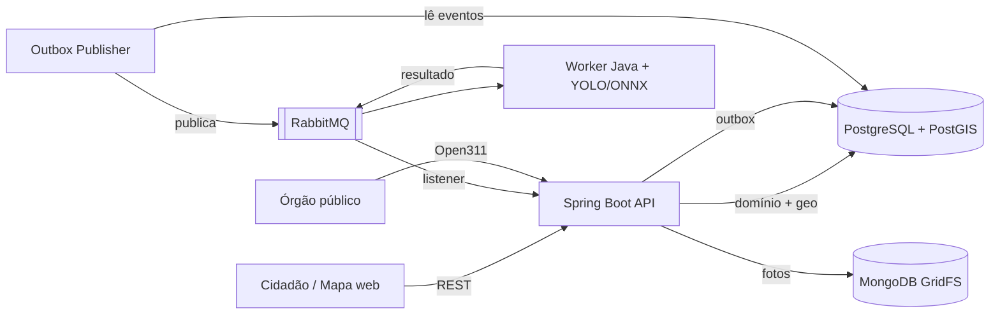
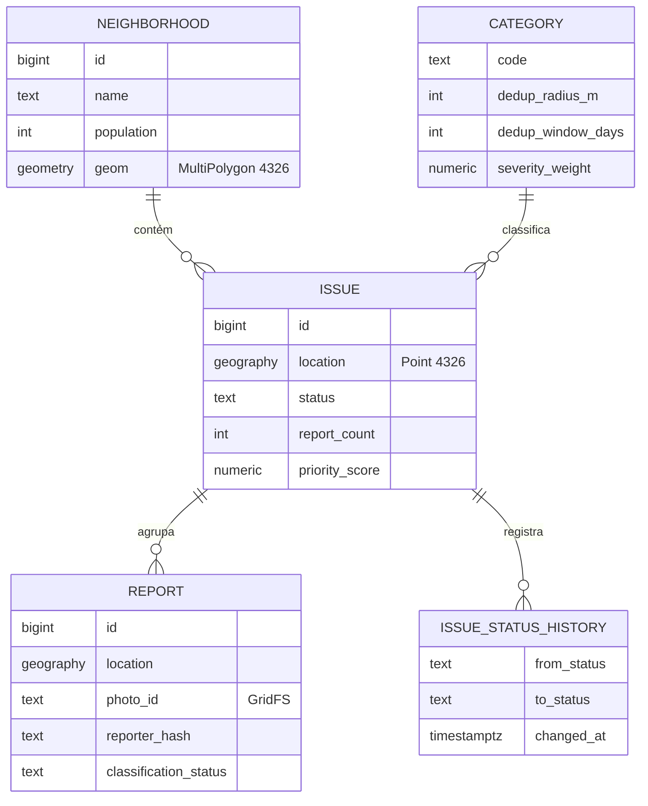

# spbemestar — Zeladoria Urbana Colaborativa

API para o cidadão reportar problemas urbanos — buracos, lixo descartado irregularmente, postes apagados, calçadas sem acessibilidade — com **deduplicação geoespacial**, **priorização por bairro** e **exportação no padrão Open311** para órgãos públicos.

> O cidadão fotografa o problema → a API registra a localização → relatos do mesmo ponto são agrupados em um único chamado → tudo aparece em um mapa com indicadores por bairro.

[](https://github.com/caioeduardopereirafelix/Sp-Bem-Estar/actions/workflows/ci.yml)


---

## Sumário

- [O problema](#o-problema)
- [Funcionalidades](#funcionalidades)
- [Arquitetura](#arquitetura)
- [Decisões técnicas](#decisões-técnicas)
- [Modelo de dados](#modelo-de-dados)
- [Endpoints](#endpoints)
- [Como rodar](#como-rodar)
- [Testes](#testes)
- [Estrutura do projeto](#estrutura-do-projeto)
- [Roadmap](#roadmap)

---

## O problema

Canais de zeladoria costumam receber o mesmo problema dezenas de vezes, sem localização precisa e sem nenhuma visão consolidada. O resultado é retrabalho para o órgão público e a sensação, para o cidadão, de que reportar não adianta.

Este projeto ataca três pontos:

1. **Duplicidade** — vários relatos do mesmo buraco viram **um único chamado**, com contador de relatos.
2. **Priorização** — chamados são ordenados por severidade, volume e tempo em aberto, **normalizados pela população do bairro**.
3. **Integração** — os dados saem no padrão aberto **Open311**, consumível por sistemas de prefeituras.

## Funcionalidades

**Cidadão**
- Reportar um problema com foto, localização e categoria
- Visualizar no mapa os problemas abertos, filtrando por categoria e status
- Acompanhar quantas pessoas reportaram o mesmo ponto e o histórico de status

**Órgão público**
- Ranking de bairros por problemas a cada 10 mil habitantes
- Fila de atendimento priorizada
- Atualização de status: `OPEN → CONFIRMED → IN_PROGRESS → RESOLVED`
- Exportação no padrão Open311 GeoReport v2

**Plataforma**
- Classificação automática da foto por modelo de visão computacional (assíncrona)
- Remoção de metadados EXIF e anonimização do autor (LGPD)
- Rate limit por IP contra spam e força bruta no login
- Métricas expostas para Prometheus

## Arquitetura



**Fluxo de um relato**

1. `POST /api/v1/reports` recebe foto, latitude, longitude e categoria.
2. A foto tem o EXIF removido e é gravada no GridFS.
3. A deduplicação procura um chamado aberto da mesma categoria dentro do raio configurado. Se existir, o relato é anexado e o contador sobe; se não, um novo chamado é criado.
4. Na mesma transação, um evento `ReportCreated` é gravado na tabela de outbox.
5. O publisher envia o evento ao RabbitMQ; o worker lê a foto no GridFS, classifica a imagem e publica o resultado (`ReportClassified`).
6. A API grava o resultado no relato. Se a categoria prevista divergir da informada (`MISMATCH`) ou a confiança for baixa (`LOW_CONFIDENCE`), o relato fica marcado para moderação.

A API **nunca espera o modelo**: a classificação é uma validação posterior, não uma etapa bloqueante.

## Decisões técnicas

### Deduplicação não é só distância
Dois relatos são o mesmo problema quando coincidem **categoria + proximidade + janela de tempo + chamado ainda aberto**. O raio varia por categoria (um poste é um ponto exato; lixo se espalha), e um buraco consertado que reabre gera um chamado novo.

```sql
SELECT i.* FROM issue i
WHERE i.category_code = :category
  AND i.status <> 'RESOLVED'
  AND i.last_reported_at > :since                 -- agora - janela da categoria
  AND ST_DWithin(i.location, :point::geography, :radius)
ORDER BY i.location <-> :point::geography         -- o mais próximo, usando o índice GiST
LIMIT 1;
```

### Concorrência: travar linhas não basta
Dois relatos simultâneos do mesmo buraco podem criar dois chamados: nenhum dos dois encontra linha para travar, porque o chamado ainda não existe. A solução é travar a **área**, não a linha:

- Antes da busca, a transação adquire `pg_advisory_xact_lock` das células de **geohash** que cobrem o quadrado `ponto ± raio`.
- A célula (≈150 m) é maior que esse quadrado, então toda célula que o intercepta contém um dos quatro cantos. Dois relatos a menos de um raio de distância sempre disputam ao menos uma célula em comum — a que contém o ponto médio entre eles —, **inclusive quando estão em lados opostos da borda entre células**.
- Os locks são adquiridos em ordem fixa, o que evita deadlock, e liberados automaticamente no commit.
- Uma mudança de status concorrente com a chegada de um relato é detectada pelo `@Version` do chamado (*optimistic locking*).

Os testes disparam 20 relatos simultâneos no mesmo ponto e na borda entre duas células, e verificam que o resultado é **um único chamado com 20 relatos**.

### `geography` para pontos, `geometry` para polígonos
`ST_DWithin` sobre `geography` mede em **metros reais**, que é o que a deduplicação precisa. Os polígonos de bairro usam `geometry`, mais rápido para `ST_Contains`. Ambos com índice **GiST**.

### Priorização sem viés de volume
Bairros com mais usuários de smartphone reportam mais — o que não significa que tenham mais problemas. Por isso:

```
score = peso_severidade × ln(1 + relatos) × (1 + dias_em_aberto / 30)
```

O `ln` reduz o efeito de volume bruto, o fator de idade impede que chamados antigos sejam esquecidos, e os indicadores de bairro são apresentados **por 10 mil habitantes** (dados do IBGE).

### Outbox transacional
Gravar no banco e publicar no broker em passos separados pode perder ou duplicar eventos. O evento é gravado na **mesma transação** do relato e publicado depois por um processo dedicado. Os consumidores são idempotentes e há **DLQ** para mensagens com falha.

- O `OutboxPublisher` lê a outbox em lotes com `FOR UPDATE SKIP LOCKED` (várias instâncias não disputam o mesmo evento) e publica no exchange `spbemestar.events`, com o tipo do evento como routing key.
- O evento só é marcado como publicado após o **ack do broker** (*publisher confirms*); sem confirmação, ele é reenviado no próximo ciclo, na ordem de criação.
- A entrega é *pelo menos uma vez*: o `messageId` da mensagem é o id do evento, e é por ele que os consumidores descartam duplicatas.
- A fila `report.classification` recebe os `ReportCreated`; mensagens rejeitadas vão para `report.classification.dlq`.

| Propriedade | Padrão | Descrição |
|---|---|---|
| `app.outbox.publish-interval-ms` | `1000` | intervalo entre ciclos de publicação |
| `app.outbox.batch-size` | `100` | eventos por ciclo |
| `app.outbox.confirm-timeout` | `5s` | espera máxima pelo ack do broker |

### Classificação em Java, fora da API
O modelo é um **YOLO de classificação** (uma resposta por foto, sem caixas): para conferir se a foto mostra o problema informado, classificar basta, e o dataset se monta separando fotos em pastas por categoria. O treino é feito em Python; o modelo é exportado em **ONNX** e executado em Java pelo **ONNX Runtime**, sem Python em produção.

- O worker (`classifier-worker/`) é uma aplicação separada: a inferência usa CPU e não disputa recursos com a API, e escala sozinha conforme a fila.
- O pré-processamento repete o do treino: menor lado redimensionado para 224, recorte central, RGB em 0..1, layout CHW.
- O resultado só é publicado com o **ack do broker**; o id da mensagem de resultado deriva do id do evento de origem, então uma reentrega gera a mesma mensagem, e a API aplica só o primeiro resultado de cada relato.
- Foto inexistente ou ilegível e mensagem malformada vão direto para a **DLQ**; falhas transitórias são tentadas de novo (3 vezes, com backoff).

### Persistência poliglota
O domínio é relacional e geoespacial (PostgreSQL + PostGIS); os binários das fotos ficam no **MongoDB GridFS**. O acesso passa pela interface `PhotoStorage`, então migrar para S3 é uma nova implementação, sem tocar no domínio.

### Padrão Open311
Em vez de um formato de exportação próprio, a API implementa o **Open311 GeoReport v2**, padrão aberto adotado por cidades para sistemas de solicitação de serviços.

### Autenticação só para quem altera chamados
O cidadão continua anônimo: ver o mapa e enviar relatos não pede login. Só o órgão público se autentica, em `POST /api/v1/auth/login`, e recebe um **JWT** assinado pela própria API (HS256, validade de 8 h), enviado depois em `Authorization: Bearer <token>`.

- **Sem sessão no servidor:** cada requisição traz o token, então a API escala horizontalmente sem estado compartilhado, e sem cookies não há CSRF a proteger.
- **Rotas novas nascem protegidas:** a configuração lista o que é público e exige login para todo o resto.
- **Senhas** ficam com bcrypt. Um e-mail inexistente, uma senha errada e um usuário desativado recebem a mesma resposta, no mesmo tempo, para não revelar quem tem conta.
- **Erros 401 e 403** saem no mesmo formato `ProblemDetail` das demais respostas de erro.

### Rate limit por IP
Cada IP tem um **token bucket** por regra, guardado em memória (Bucket4j + Caffeine). A primeira regra que casar com a requisição é a que conta:

| Regra | Rota | Limite por IP |
|---|---|---|
| `login` | `POST /api/v1/auth/login` | 5 por minuto |
| `reports` | `POST /api/v1/reports` | 20 por hora |
| `metrics` | `GET /actuator/prometheus` | 30 por minuto (um scrape a cada 15 s usa 4) |
| `api` | demais rotas em `/api/**` | 300 por minuto |

- **Antes do Spring Security:** uma força bruta no login é barrada sem nem conferir a senha, e um token inválido também consome o limite.
- **Reposição gradual:** com 5 por minuto, uma ficha volta a cada 12 s, em vez de o limite zerar de uma vez no fim da janela.
- **Resposta `429`** em `ProblemDetail`, com `Retry-After` em segundos. Toda resposta limitada traz `X-RateLimit-Limit` e `X-RateLimit-Remaining`.
- **IPv6 conta pelo prefixo /64**, que é o que um provedor entrega a um único cliente; contar por endereço deixaria qualquer um trocar de IP a cada requisição.
- **Livres:** mapa web, Swagger e health check.
- **Por instância:** com várias réplicas, cada uma conta separadamente. Para um limite global, o Bucket4j aceita Redis ou PostgreSQL como armazenamento.

**Atrás de um proxy reverso** (nginx, load balancer), o IP da conexão é o do proxy, e todos os clientes dividiriam o mesmo limite. Nesse caso, defina `SERVER_FORWARD_HEADERS_STRATEGY=native` para a API usar o `X-Forwarded-For`. Por padrão o Tomcat só aceita esse header vindo de IPs de rede privada; se o proxy estiver em outro endereço, informe-o em `SERVER_TOMCAT_REMOTEIP_TRUSTED_PROXIES` (expressão regular). Sem proxy, não ligue essa opção: qualquer cliente poderia forjar o header e escapar do limite.

### Outras proteções
- **Foto com teto de 40 megapixels.** O limite é conferido no cabeçalho da imagem, antes de decodificá-la. Sem ele, um PNG de 1 MB que declara 30 000 × 30 000 pixels exigiria gigabytes de memória ao ser aberto (*decompression bomb*) e derrubaria a API.
- **Content Security Policy no mapa.** A página só carrega scripts, estilos e imagens da própria API, do Leaflet no cdnjs e dos tiles do OpenStreetMap, e não pode ser embutida em outro site. Assim, um script injetado não roda e não envia dados para fora. Só o Swagger UI aceita estilos inline, porque precisa deles.
- **Leaflet com Subresource Integrity.** O navegador confere o hash do arquivo e o recusa se o CDN entregar algo diferente da versão 1.9.4.
- **Métricas com senha.** O `/actuator/prometheus` revela rotas, volumes e erros, por isso exige `METRICS_USER` e `METRICS_PASSWORD` (HTTP Basic, como o Prometheus espera). Sem essas variáveis, ninguém lê as métricas.
- **Bancos só em `127.0.0.1`.** O Docker Compose publica PostgreSQL, RabbitMQ e MongoDB apenas na máquina local. Sem isso, o Docker abre as portas para a rede inteira, inclusive passando por cima do firewall do host (ufw).
- **Dependências sem vulnerabilidades conhecidas.** Tomcat, Jackson e o cliente do RabbitMQ estão fixados acima das versões do Spring Boot 4.1.1, conferidas no [OSV](https://osv.dev). Essas linhas do `pom.xml` saem quando o Boot trouxer versões iguais ou mais novas.
- **Swagger desligável:** em produção, `API_DOCS_ENABLED=false`.

### Privacidade (LGPD)
- Metadados EXIF são descartados antes do armazenamento.
- O autor do relato é guardado apenas como hash.
- Nenhum endpoint público expõe dados pessoais.

## Modelo de dados



### Categorias

As categorias cobrem os incidentes mais frequentes da zeladoria de São Paulo (SP156 e Ouvidoria) que aparecem numa foto. O raio e a janela definem quando dois relatos são o mesmo problema; o peso entra no priority score.

| Código | Categoria | Raio | Janela | Peso |
|---|---|---|---|---|
| `TREE` | Árvore caída ou com risco de queda | 20 m | 30 dias | 2,00 |
| `FLOODING` | Alagamento | 50 m | 2 dias | 2,00 |
| `SEWAGE` | Esgoto a céu aberto | 20 m | 30 dias | 1,80 |
| `POTHOLE` | Buraco na via | 15 m | 30 dias | 1,50 |
| `CLOGGED_DRAIN` | Bueiro ou boca de lobo entupida | 10 m | 30 dias | 1,50 |
| `SIDEWALK` | Calçada danificada ou sem acessibilidade | 20 m | 90 dias | 1,20 |
| `STREETLIGHT` | Poste ou iluminação pública com defeito | 10 m | 30 dias | 1,20 |
| `TRASH` | Descarte irregular de lixo ou entulho | 30 m | 7 dias | 1,00 |
| `BUS_STOP` | Ponto de ônibus danificado | 10 m | 60 dias | 1,00 |
| `OVERGROWN` | Mato alto ou terreno sem capinação | 50 m | 60 dias | 0,80 |

Problemas passageiros (alagamento, lixo) têm janela curta, para que uma ocorrência nova não seja agrupada com uma já resolvida; problemas que só somem com reparo (calçada, mato) têm janela longa.

As migrations ficam em `src/main/resources/db/migration` e são aplicadas pelo Flyway. O Hibernate apenas valida o schema (`ddl-auto: validate`).

## Endpoints

| Método | Rota | Descrição |
|---|---|---|
| `POST` | `/api/v1/reports` | Cria um relato (multipart: foto, lat, lon, categoria) |
| `GET` | `/api/v1/issues?bbox=&category=&status=` | Chamados em GeoJSON para o mapa |
| `GET` | `/api/v1/issues/{id}` | Detalhe, relatos e histórico |
| `POST` | `/api/v1/auth/login` | Login do órgão público; devolve um token JWT |
| `PATCH` | `/api/v1/issues/{id}/status` | Atualiza o status do chamado (🔒 operador) |
| `GET` | `/api/v1/neighborhoods?city=` | Distritos em GeoJSON com os indicadores (para o mapa) |
| `GET` | `/api/v1/neighborhoods/stats` | Indicadores por bairro (normalizados) |
| `GET` | `/api/v1/categories` | Categorias ativas |
| `GET` | `/api/v1/photos/{id}` | Foto do relato |
| `GET` | `/open311/v2/services.json` | Categorias no padrão Open311 |
| `GET` | `/open311/v2/requests.json` | Chamados no padrão Open311 |

Documentação interativa: `http://localhost:8080/swagger-ui.html`

## Como rodar

**Pré-requisitos:** Java 21 e Docker.

```bash
# 1. Sobe PostgreSQL/PostGIS, RabbitMQ e MongoDB
docker compose up -d --wait

# 2. Executa a aplicação
./mvnw spring-boot:run
```

Além das variáveis de banco e mensageria, o `.env` precisa de:

| Variável | Para quê |
|---|---|
| `JWT_SECRET` | chave que assina os tokens, com no mínimo 32 bytes (`openssl rand -base64 48`) |
| `OPERATOR_EMAIL`, `OPERATOR_PASSWORD`, `OPERATOR_NAME` | primeiro operador do órgão público, criado na subida se ainda não existir (senha com 12+ caracteres) |
| `RATE_LIMIT_ENABLED` | opcional; `false` desliga o [rate limit por IP](#rate-limit-por-ip) (padrão `true`) |
| `METRICS_USER`, `METRICS_PASSWORD` | usuário e senha que o Prometheus usa no `/actuator/prometheus`; sem eles, as métricas ficam fechadas |
| `API_DOCS_ENABLED` | opcional; `false` desliga o Swagger UI e o `/v3/api-docs` (padrão `true`) |

Com o operador criado, entre pela **Área do operador** no mapa para mudar o status dos chamados, ou use o Swagger UI: faça `POST /api/v1/auth/login` e cole o `accessToken` em **Authorize**.

| Serviço | Endereço |
|---|---|
| Mapa | http://localhost:8080 |
| API | http://localhost:8080/api/v1 |
| Swagger UI | http://localhost:8080/swagger-ui.html |
| Health | http://localhost:8080/actuator/health |
| Métricas | http://localhost:8080/actuator/prometheus (usuário e senha do Prometheus) |
| Painel RabbitMQ | http://localhost:15672 (usuário e senha do `.env`) |

No Prometheus, o job fica assim:

```yaml
scrape_configs:
  - job_name: spbemestar-api
    metrics_path: /actuator/prometheus
    basic_auth:
      username: prometheus           # METRICS_USER
      password_file: /etc/prometheus/spbemestar-password  # conteúdo de METRICS_PASSWORD
    static_configs:
      - targets: ["api:8080"]
```

> Na primeira subida com volumes novos, o PostgreSQL reinicia uma vez para instalar a extensão PostGIS. Se a aplicação falhar ao conectar, aguarde alguns segundos e execute novamente.

> Se você já rodou o projeto quando ele usava MongoDB 8, o container do Mongo vai sair com `Wrong mongod version`: a 7.0 não abre dados gravados pela 8. Em desenvolvimento, apague só o volume das fotos com `docker volume rm spbemestar_mongodata` e suba de novo.

### Importar bairros

Os limites de bairros são importados de um arquivo **GeoJSON** (`FeatureCollection` com `Polygon` ou `MultiPolygon`). A importação reprojeta para WGS84, corrige geometrias inválidas, atualiza bairros já existentes e associa ao bairro os chamados já registrados.

O repositório já inclui os **96 distritos de São Paulo** com a população do Censo 2022 em [`data/sp-distritos.geojson`](data/sp-distritos.geojson):

```bash
./mvnw spring-boot:run "-Dspring-boot.run.arguments=--app.neighborhoods.import-file=data/sp-distritos.geojson '--app.neighborhoods.city=São Paulo'"
```

Valores com espaço, como `São Paulo`, precisam ficar entre aspas simples dentro de `spring-boot.run.arguments`.

| Propriedade | Padrão | Descrição |
|---|---|---|
| `import-file` | — | caminho do GeoJSON |
| `city` | — | cidade dos bairros importados |
| `name-property` | `name` | propriedade com o nome do bairro |
| `population-property` | `population` | propriedade com a população (opcional) |
| `source-srid` | `4326` | sistema de coordenadas do arquivo (ex.: `31983` para SIRGAS 2000 / UTM 23S) |

**Fontes dos dados de São Paulo:** limites dos distritos do [GeoSampa](https://geosampa.prefeitura.sp.gov.br) (Prefeitura de São Paulo) e população do Censo 2022 do [IBGE/SIDRA](https://sidra.ibge.gov.br/tabela/9923) (tabela 9923). O arquivo é gerado por `node scripts/build-sp-distritos.mjs`, que baixa as duas fontes e as cruza pelo nome do distrito.

### Worker de classificação

O worker consome `report.classification`, lê a foto no GridFS e publica o resultado para a API. Ele usa o mesmo `.env` da raiz.

```bash
./mvnw -f classifier-worker/pom.xml package
java -jar classifier-worker/target/classifier-worker-0.0.1-SNAPSHOT.jar --classifier.model=file:caminho/do/modelo.onnx
```

O modelo é treinado pelo notebook [`classifier-worker/training`](classifier-worker/training/README.md), no Google Colab, e os nomes das categorias vão gravados dentro do próprio `.onnx` (metadado `names`); o worker lê de lá, então a ordem dos rótulos nunca fica desalinhada com as saídas do modelo.

Enquanto o modelo treinado não existe, dá para ver o fluxo inteiro com o modelo de teste, que classifica pela cor dominante da foto (vermelho = `POTHOLE`, verde = `TRASH`, azul = `OTHER`): `--classifier.model=file:classifier-worker/src/test/resources/models/color-test.onnx`.

| Propriedade | Padrão | Descrição |
|---|---|---|
| `classifier.model` | `file:models/classifier.onnx` (ou `CLASSIFIER_MODEL`) | modelo ONNX |
| `classifier.labels` | — (lidos do modelo) | só para modelos sem o metadado `names`; se informado junto com ele, precisa ser igual |
| `classifier.model-version` | `dev` (ou `CLASSIFIER_MODEL_VERSION`) | enviado junto com cada resultado |
| `app.classification.min-confidence` (API) | `0.6` | abaixo disso o relato vai para moderação |

## Testes

Os testes de integração usam **Testcontainers** com PostGIS, RabbitMQ e MongoDB reais — sem mocks de banco. É necessário ter o Docker em execução.

O [CI](.github/workflows/ci.yml) roda as duas suítes em paralelo a cada pull request e a cada push na `main`; quando um teste falha, os relatórios do Surefire ficam disponíveis como artefato da execução.

```bash
./mvnw verify                                # API
./mvnw -f classifier-worker/pom.xml verify   # worker de classificação
```

Cenários cobertos:
- relatos próximos da mesma categoria são agrupados no mesmo chamado;
- relatos simultâneos do mesmo ponto não geram chamados duplicados;
- chamados resolvidos não recebem novos relatos;
- transições de status inválidas são rejeitadas;
- indicadores por bairro respeitam a normalização por população;
- eventos da outbox são publicados uma única vez;
- o worker classifica a foto e publica o resultado; reentregas geram o mesmo id de resultado;
- fotos inexistentes ou ilegíveis vão para a DLQ;
- a API marca para moderação divergências e baixa confiança, e aplica só o primeiro resultado de cada relato;
- o rate limit barra o login antes da autenticação, separa os contadores por IP, por regra e por prefixo IPv6 /64, repõe as fichas com o tempo e deixa o mapa e o actuator livres.

Nos demais testes o rate limit fica desligado (`src/test/resources/config/application.yml`), porque todas as requisições do MockMvc vêm de `127.0.0.1`.

## Estrutura do projeto

Organizado em camadas (MVC):

```
src/main/java/com/br/spbemestar/
├── controller/   # endpoints REST e Open311
├── listener/     # consumidores do RabbitMQ (resultado da classificação)
├── service/      # regras de aplicação: deduplicação, priorização, fotos (GridFS, remoção de EXIF)
├── repository/   # acesso a dados (Spring Data JPA + consultas PostGIS)
├── model/        # entidades JPA e enums: Issue, Report, Category, Neighborhood, OutboxEvent
├── exception/    # exceções de domínio
└── util/         # utilitários geográficos
```

O worker de classificação é um projeto Maven à parte, na mesma estrutura de camadas:

```
classifier-worker/
├── scripts/make_test_model.py   # gera os modelos ONNX usados nos testes
├── training/                    # notebook de treino no Google Colab
└── src/main/java/com/br/spbemestar/classifier/
    ├── listener/   # consumo de ReportCreated
    ├── service/    # pré-processamento, inferência (ONNX Runtime), leitura no GridFS, publicação
    ├── dto/        # mensagens trocadas com a API
    └── config/     # topologia do RabbitMQ e propriedades do modelo
```

As regras que protegem a consistência de uma entidade ficam nela mesma — por exemplo, `Issue.changeStatus()` valida a transição de status e gera o registro de histórico.

## Stack

| Camada | Tecnologia |
|---|---|
| Linguagem | Java 21 |
| Framework | Spring Boot 4.1 (Web MVC, Data JPA, Data MongoDB, AMQP, Validation, Actuator) |
| Banco relacional | PostgreSQL 16 + PostGIS 3.4 |
| ORM geoespacial | Hibernate Spatial (JTS) |
| Migrations | Flyway |
| Armazenamento de fotos | MongoDB 7 (GridFS) — a 8.x não sobe em kernels Linux 6.19 a 7.0.13 ([SERVER-121912](https://jira.mongodb.org/browse/SERVER-121912)) |
| Mensageria | RabbitMQ 4 |
| Classificação | YOLO de classificação exportado em ONNX, executado em Java com ONNX Runtime (worker separado) |
| Documentação | springdoc-openapi |
| Observabilidade | Micrometer + Prometheus |
| Testes | JUnit 6, Testcontainers |

## Roadmap

**Fase 1 — Núcleo**
- [x] Ambiente com Docker Compose (PostGIS, RabbitMQ, MongoDB)
- [x] Schema e migrations
- [x] Criação de relatos com foto no GridFS
- [x] Deduplicação geoespacial
- [x] Consulta de chamados em GeoJSON

**Fase 2 — Bairros e ciclo de vida**
- [x] Importador de bairros (GeoJSON, com reprojeção)
- [x] Carga dos distritos de São Paulo com população (IBGE)
- [x] Indicadores normalizados e priority score
- [x] Ciclo de status com histórico
- [x] Mapa web (Leaflet)

**Fase 3 — Assíncrono e robustez**
- [x] Outbox + RabbitMQ com DLQ
- [x] Worker de classificação (Java + ONNX Runtime)
- [x] Notebook de treino do modelo YOLO de classificação (Colab)
- [ ] Modelo treinado com fotos reais
- [ ] Job de merge de duplicatas
- [x] Rate limit por IP
- [x] Remoção de EXIF

**Fase 4 — Integração e entrega**
- [ ] Endpoints Open311
- [ ] Carga com dataset público e benchmarks
- [x] CI com GitHub Actions
- [ ] Deploy com demo pública
